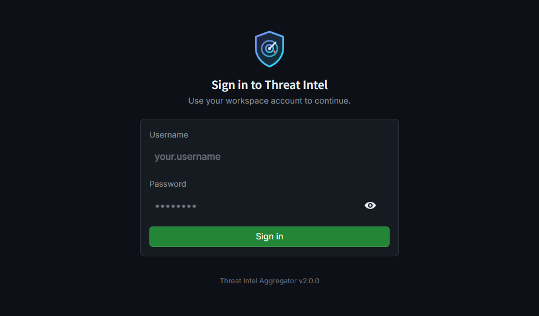
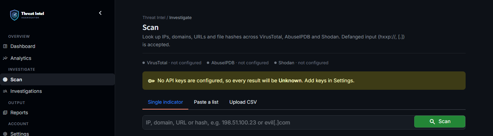
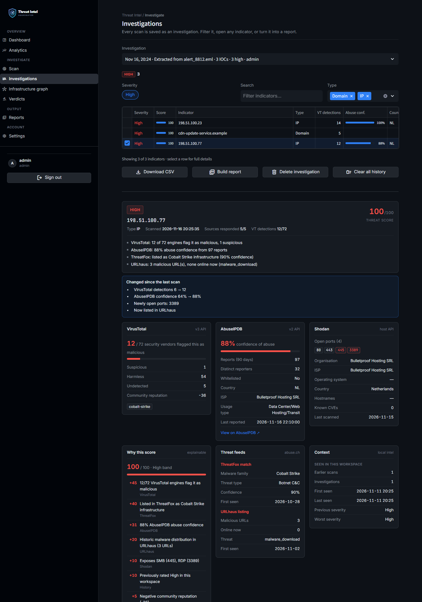
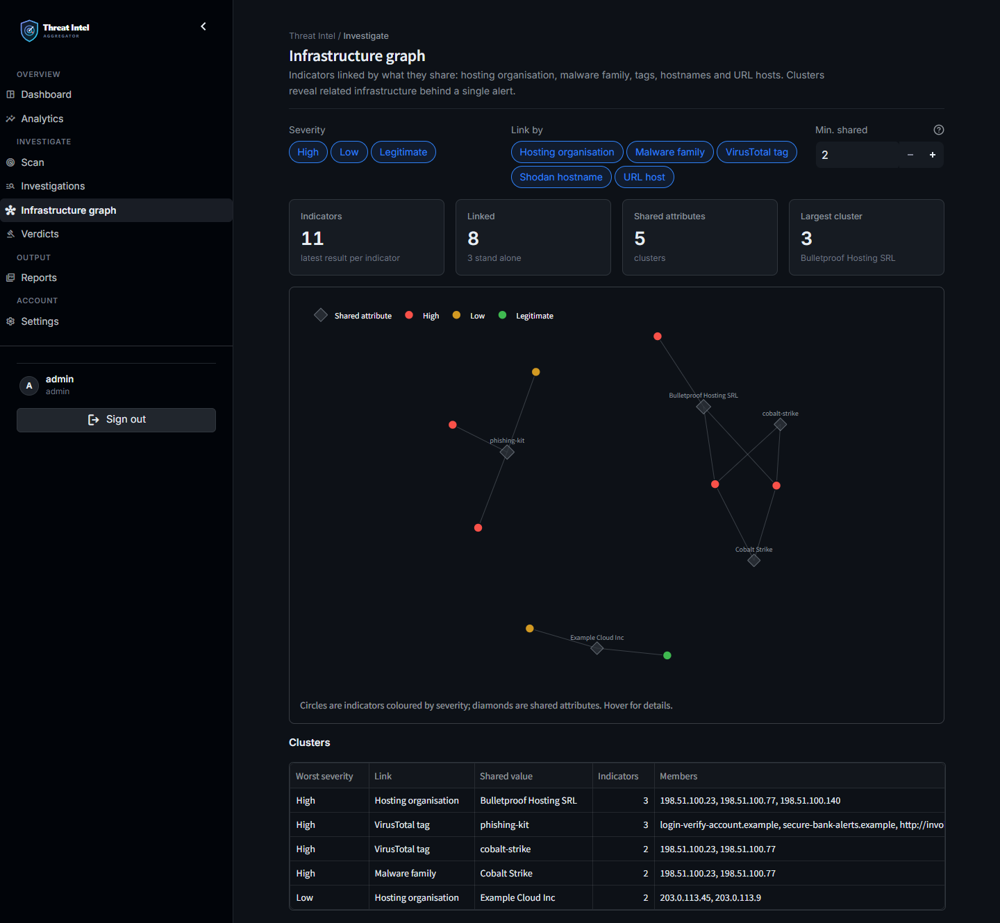
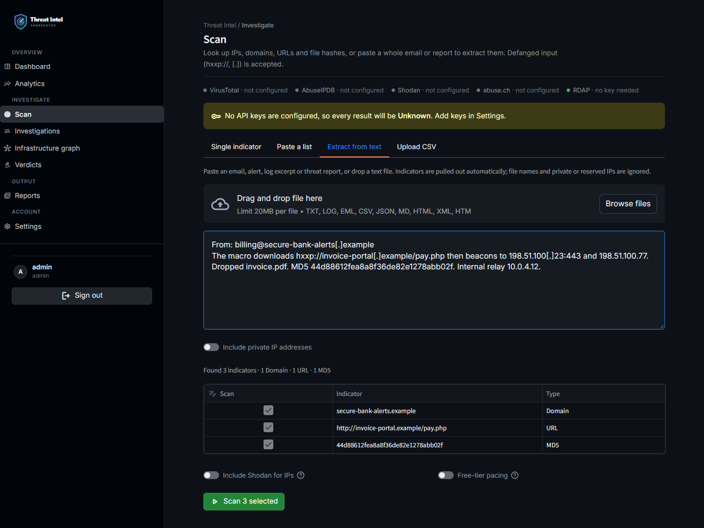
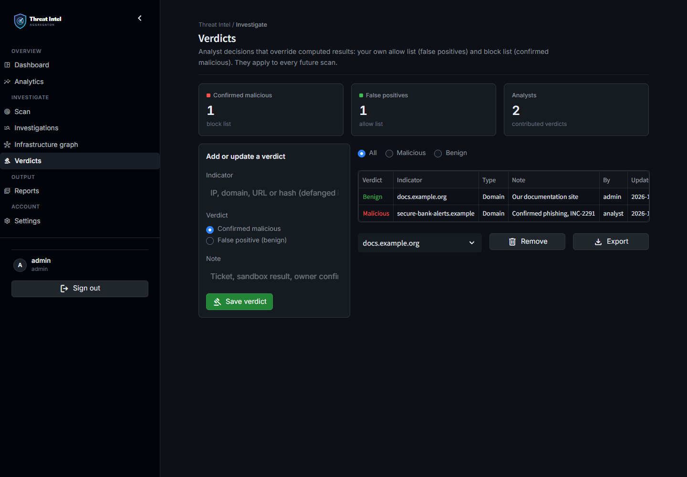
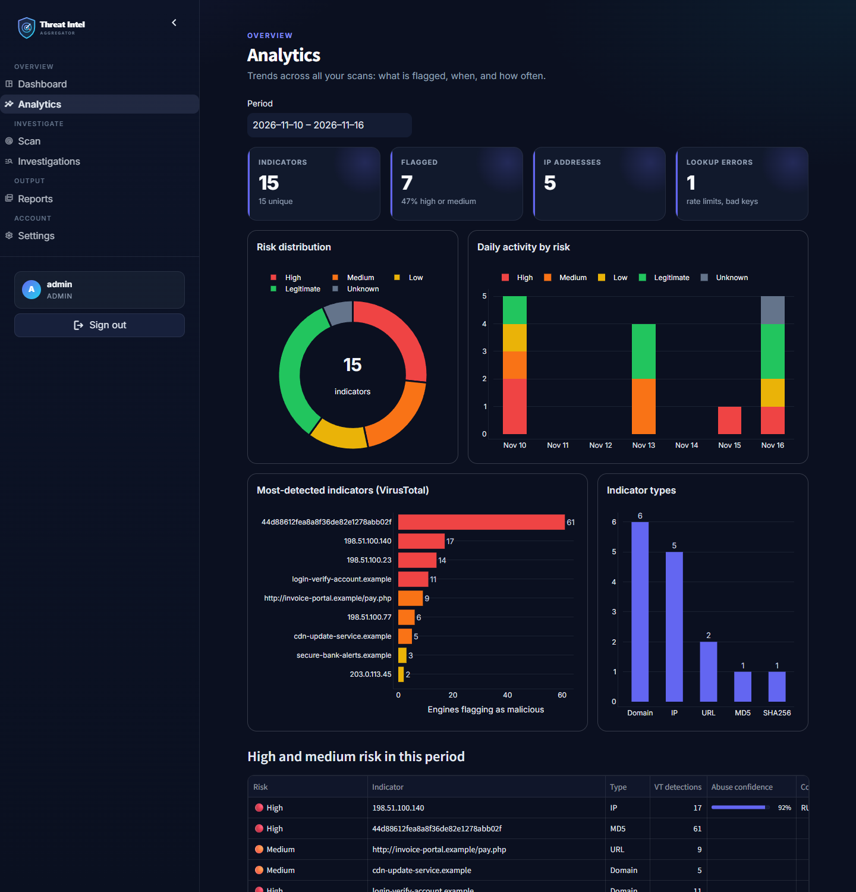
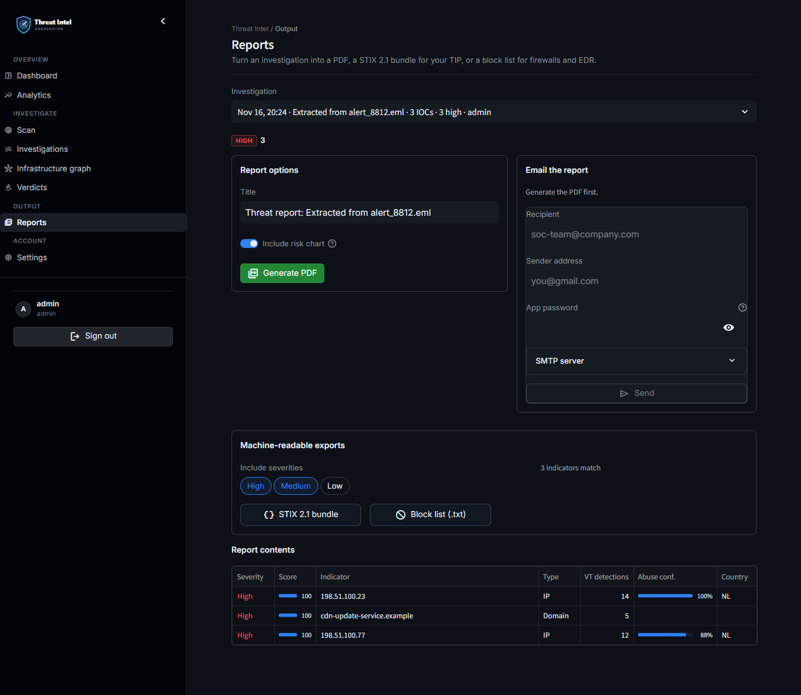
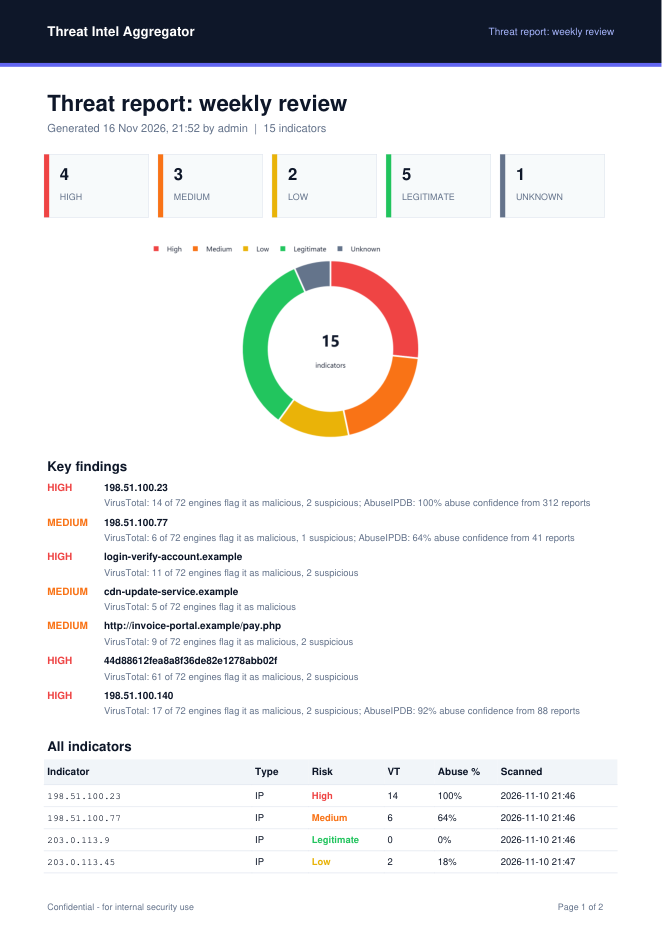
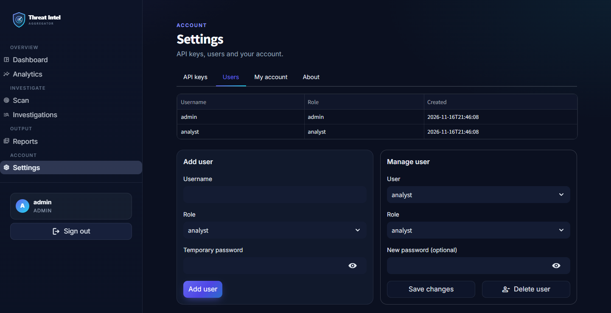

<div align="center">


# Threat Intel Aggregator

**Triage IPs, domains, URLs and file hashes across VirusTotal, AbuseIPDB, Shodan, abuse.ch and RDAP. Each indicator gets an explainable 0–100 threat score, the app remembers what your team has seen, and results export to PDF, STIX 2.1 or a block list.**


</div>

---

## Table of contents

- [Why this exists](#why-this-exists)
- [Features](#features)
- [Screenshots](#screenshots)
- [How it works](#how-it-works)
- [Risk scoring](#risk-scoring)
- [Tech stack](#tech-stack)
- [Getting started](#getting-started)
- [Getting API keys](#getting-api-keys)
- [Configuration](#configuration)
- [Usage guide](#usage-guide)
- [Users and roles](#users-and-roles)
- [Deployment](#deployment)
- [Project structure](#project-structure)
- [Running the tests](#running-the-tests)
- [Security](#security)
- [Troubleshooting](#troubleshooting)
- [Roadmap](#roadmap)
- [Contributing](#contributing)
- [Disclaimer](#disclaimer)

---

## Why this exists

When an alert fires, an analyst usually opens three browser tabs, pastes the same indicator into VirusTotal, AbuseIPDB and Shodan, then tries to combine what they see into one judgement. Threat Intel Aggregator does that in one step:

- **One input, six sources.** Results appear side by side.
- **One verdict.** Each indicator gets a single risk level, with the reasons behind it.
- **Nothing gets lost.** Every scan is saved as an investigation you can search, chart and report on later.

### More than an API wrapper

Calling three APIs is the easy part. These features produce intelligence that none of the sources gives you on its own:

| Feature | What it adds |
|---|---|
| **Explainable threat score** | A 0–100 score built from named factors (detections, abuse reports, exposed services, CVEs, domain age, feed listings, local history). Every point is shown with its reason. |
| **Workspace memory** | First seen, last seen, how often, and in which investigations, across your whole team. |
| **Change detection** | Rescan an indicator and see exactly what changed: "VirusTotal 6 → 12, port 3389 newly open, now listed in URLhaus". |
| **Analyst verdicts** | Mark an indicator confirmed malicious or a false positive. That decision overrides the computed result in every later scan. |
| **Extract from text** | Paste an email, alert or report; every indicator is pulled out (defanged or not) and file names and private IPs are filtered. |
| **Infrastructure graph** | Indicators linked by shared hosting, malware family, tags and hosts, so one alert reveals the cluster behind it. |
| **STIX 2.1 and block lists** | Push results into MISP or OpenCTI, or straight into a firewall deny list. |

It's built for SOC analysts, incident responders, students learning threat intelligence, and anyone who triages suspicious indicators.

---

## Features

### Scanning
- **Single, list or CSV.** Scan one indicator, paste a list, or upload a CSV. The app guesses which column holds the indicators.
- **Detects the type automatically.** Recognises IPv4/IPv6, domains, URLs, and MD5, SHA1 and SHA256 hashes.
- **Cleans up defanged input.** `hxxp://evil[.]com`, `1.2.3[.]4`, `bad(.)site` and `[dot]` are converted back before lookup, and your original input is kept.
- **Removes duplicates.** Repeated indicators in a list are scanned once.
- **Skips private IPs.** RFC 1918 and other reserved addresses aren't sent to external APIs, which saves quota.
- **Handles rate limits.** It retries when an API answers HTTP 429. An optional **free-tier pacing** mode waits 15 seconds between lookups to stay within VirusTotal's free limit.
- **Saves as it goes.** Each result is stored the moment it's ready, so stopping a batch halfway keeps the work already done.

- **Extract from text.** Paste an email, alert, log or threat report (or drop a `.txt`, `.log`, `.eml`, `.csv`, `.json` file). Every IP, domain, URL and hash is extracted, including defanged ones. Hosts already covered by a URL, file names such as `invoice.pdf`, XML namespace hosts and private IPs are dropped. Review the list, untick anything, then scan.

### Results
- **Threat score.** A 0–100 score with a "Why this score" breakdown listing every factor and its points. See [Risk scoring](#risk-scoring).
- **Changes since the last scan.** Severity, score, detections, abuse confidence, open ports, CVEs and feed listings are compared with the previous result.
- **Context card.** Domain age, registrar and expiry from RDAP, plus how often the indicator has been seen in this workspace and its worst previous severity.
- **Threat feeds card.** ThreatFox malware family, threat type and confidence; URLhaus malicious URL count and how many are online now.
- **Verdict card.** A risk badge, the reasons in plain language (for example "VirusTotal: 14 of 72 engines flag it as malicious"), notes, and any lookup errors.
- **One card per source:**
  - **VirusTotal:** detection ratio bar, suspicious/harmless/undetected counts, reputation, tags, and the list of engines that flagged it.
  - **AbuseIPDB:** abuse confidence bar, number of reports and reporters, whitelist status, country, ISP and usage type.
  - **Shodan:** open ports (risky services such as RDP, SMB and Telnet highlighted), organisation, operating system, country, hostnames and known CVEs.
- **Raw JSON** from every source, plus a direct link to each provider's page for that indicator.

### Investigations and analytics
- **Infrastructure graph.** An interactive graph linking indicators through shared hosting organisation, ThreatFox malware family, VirusTotal tags, Shodan hostnames and URL hosts, with a cluster table ranked by severity.
- **Verdicts.** A page listing every analyst verdict, where you can add, filter, remove and export your allow list and block list.
- **Investigations.** Every scan is saved. Filter by risk, type or free text, click any row to see its full details, export to CSV, or delete it.
- **Dashboard.** KPI cards, risk distribution, daily activity, and your latest indicators.
- **Analytics.** Pick any date range to see the risk mix, daily activity by risk, the top 10 most-detected indicators, the indicator types, and a list of everything High or Medium risk.

### Reporting
- **PDF reports.** Each report has a branded header, summary tiles, a risk chart, key findings with reasons, the full indicator table, and a section listing lookup problems. It handles any number of rows across pages.
- **Email delivery.** Send the PDF through Gmail (with an App Password) or any SMTP server.
- **STIX 2.1 bundle.** One Indicator per IOC with a proper pattern, the threat score as confidence and malware families as labels. Imports into MISP, OpenCTI and most threat-intel platforms.
- **Block list.** Plain text grouped by type, one indicator per line, for firewall or EDR deny lists.
- **CSV export** of any batch or investigation.

### Accounts and security
- **No default password.** On first launch you create the administrator account.
- **Hashed passwords.** Salted PBKDF2-SHA256 with 260,000 iterations, checked in constant time.
- **Roles.** Admins manage API keys and users and see every user's history. Analysts scan and see only their own work.
- **Login lockout.** After 5 failed attempts, sign-in is paused for 30 seconds.
- **Keys from secrets or environment variables**, so they never need to be stored in the database.

---

## Screenshots

> All screenshots use synthetic sample data (documentation IP ranges and `.example` domains).

| Login | Scan |
|---|---|
|  |  |

| Indicator detail: threat score, changes, feeds and context | Infrastructure graph |
|---|---|
|  |  |

| Extract indicators from text | Analyst verdicts |
|---|---|
|  |  |

| Investigations | Analytics |
|---|---|
|  |  |

| Reports | PDF output |
|---|---|
|  |  |

| User management |
|---|
|  |

---

## How it works

```
                    ┌──────────────────────────┐
  Browser  ───────▶ │  streamlit_app.py        │  theme · login gate · navigation
                    └────────────┬─────────────┘
                                 │
    ┌──────────┬──────────┬──────┼───────┬──────────┬──────────┬─────────┬─────────┐
    ▼          ▼          ▼      ▼       ▼          ▼          ▼         ▼         ▼
 Dashboard Analytics    Scan  Investig. Graph    Verdicts   Reports  Settings
                          │  (tia.extract pulls IOCs out of free text)
                          ▼
            tia.scanner.scan_ioc(indicator, store)
               │
               ├─ tia.ioc          refang → classify → normalise
               ├─ tia.sources      VirusTotal (every type)
               │                   AbuseIPDB + Shodan (public IPs)
               │                   ThreatFox + URLhaus (abuse.ch key)
               │                   RDAP (domains and URL hosts, no key)
               ├─ tia.intel        sightings + diff against the last scan
               └─ tia.threatscore  rule verdict (tia.scoring) + 0–100 factor score
                                   + analyst verdict override
                          │
                          ▼
            tia.storage  ──▶  data/threatintel.db (SQLite, WAL)
                          │
       ┌──────────────┬───┴──────────┬──────────────────┐
       ▼              ▼              ▼                  ▼
  tia.charts     tia.graph      tia.report          tia.export
  (Plotly)       (pivot graph)  (PDF, SMTP)         (STIX 2.1, block list)
```

- All application logic lives in the `tia/` package as plain Python, separate from the UI. That makes it easy to test and reuse from scripts.
- The source clients never raise exceptions. Each returns `{"ok": ..., "error": ...}`, so one failing API can't break a scan.
- SQLite in WAL mode lets several browser sessions read and write at the same time safely.

---

## Risk scoring

Severity is decided in three layers.

**1. Source verdict.** Each source produces its own level, and the indicator takes **the most severe one**.

| Source | 🔴 High | 🟠 Medium | 🟡 Low | 🟢 Legitimate |
|---|---|---|---|---|
| **VirusTotal**: engines flagging as malicious (all types) | ≥ 10 | 4 – 9 | 1 – 3 | 0 |
| **AbuseIPDB**: abuse confidence score (public IPs only) | ≥ 80 % | 30 – 79 % | 1 – 29 % | 0 % |
| **ThreatFox**: listed as malware infrastructure | confidence ≥ 50 % | below 50 % | | |
| **URLhaus**: listed for malware distribution | a URL online now | listed, none online | | |

Not being listed in a feed is not evidence of safety, so it never sets a level.

**2. Threat score (0–100).** Every point comes from a named factor shown in the UI:

| Factor | Points |
|---|---|
| VirusTotal malicious engines | 4.5 each, up to 45 |
| VirusTotal suspicious engines | 2 each, up to 8 |
| Negative VirusTotal community reputation (≤ −10) | 5 |
| AbuseIPDB confidence | 0.35 × confidence, up to 35 |
| AbuseIPDB report volume (≥ 50 reports) | 5 |
| AbuseIPDB whitelisted | −15 |
| Risky exposed services (FTP, Telnet, SMB, RDP, VNC, databases, Docker API…) | 5 each, up to 15 |
| Known CVEs on the host (Shodan) | 3 each, up to 15 |
| ThreatFox listing | 40 |
| URLhaus listing | 35 if online now, 20 if historic |
| Domain registered < 30 days ago / < 180 days ago (RDAP) | 15 / 7 |
| Previously rated High or Medium in this workspace | 10 |
| Seen in 3 or more investigations | 3 |

Bands: **≥ 70 High**, **40–69 Medium**, **15–39 Low**, below 15 Legitimate. The score can **raise** severity when several moderate signals add up, for example VirusTotal 9 plus AbuseIPDB 75 % becomes High. It **never lowers** severity below the source verdict.

**3. Analyst verdict.** A saved verdict (confirmed malicious → High, false positive → Legitimate) overrides both layers in every future scan, and the reason names the analyst.

- ⚪ **Unknown** means no reputation source returned data: missing keys, rate limits, network errors, or a private IP. **Unknown is never treated as clean.** The score is still shown for context.
- If AbuseIPDB has **whitelisted** an IP, its AbuseIPDB level is cancelled, but VirusTotal detections still count.

---

## Tech stack

| Layer | Technology |
|---|---|
| Language | Python 3.8+ |
| Web UI | [Streamlit](https://streamlit.io) (multi-page `st.navigation`, dialogs, interactive tables) |
| Data | pandas |
| Charts | Plotly (+ Kaleido for chart images in the PDF) |
| PDF | fpdf2 |
| HTTP / APIs | requests, official `shodan` SDK |
| Threat intel | VirusTotal v3, AbuseIPDB v2, Shodan, abuse.ch ThreatFox and URLhaus, RDAP |
| Graph layout | NumPy force-directed layout (no extra dependency) |
| Exports | STIX 2.1 JSON (hand-built, no extra dependency) |
| Storage | SQLite (standard library) |
| Auth | PBKDF2-SHA256 via `hashlib` (standard library) |
| Testing | pytest, Streamlit `AppTest` |

---

## Getting started

### Prerequisites

- **Python 3.8 or newer** ([download](https://www.python.org/downloads/))
- **Git**
- *Optional:* **Google Chrome or Chromium**, so the risk chart can be embedded in PDF reports. Without it, reports are still created, just without the chart.

### Installation

```bash
# 1. Clone the repository
git clone https://github.com/ayuxsh009/threat-intel-aggregator.git
cd threat-intel-aggregator

# 2. Create and activate a virtual environment
python -m venv .venv
# Windows (PowerShell):  .venv\Scripts\Activate.ps1
# Windows (cmd):         .venv\Scripts\activate.bat
# macOS / Linux:         source .venv/bin/activate

# 3. Install dependencies
pip install -r requirements.txt

# 4. Start the app
streamlit run streamlit_app.py
```

Open **http://localhost:8501**.

### First launch

1. The **Set up your workspace** screen appears. Create the administrator account (password of at least 8 characters, mixing letters and numbers).
2. You're signed in automatically.
3. Go to **Settings → API keys**, paste your keys, click **Save keys**, then **Test connections**.

---

## Getting API keys

All of these services have free plans, and RDAP needs no key at all.

| Service | Sign up | Where to find the key | Used for |
|---|---|---|---|
| **VirusTotal** | [virustotal.com/gui/join-us](https://www.virustotal.com/gui/join-us) | Profile menu → **API key** | Every indicator type |
| **AbuseIPDB** | [abuseipdb.com/register](https://www.abuseipdb.com/register) | **Account → API → Create Key** | IP addresses |
| **Shodan** | [account.shodan.io/register](https://account.shodan.io/register) | Shown on your [account page](https://account.shodan.io) | IP addresses (optional) |
| **abuse.ch** | [auth.abuse.ch](https://auth.abuse.ch/) | Sign in, then **Optional → Auth-Key** | ThreatFox and URLhaus, one key for both (optional) |
| **RDAP** | No sign-up | No key needed | Domain age and registrar |

> **Tip:** VirusTotal is the most important key. It's the only source for domains, URLs and hashes. Free keys allow about 4 lookups per minute, so turn on **free-tier pacing** for large batches.

---

## Configuration

### API keys

Keys are looked up in this order; the first one found is used:

1. **Streamlit secrets:** `.streamlit/secrets.toml`
2. **Environment variables:** `VT_API_KEY`, `ABUSEIPDB_API_KEY`, `SHODAN_API_KEY`, `ABUSECH_API_KEY`
3. **Settings page:** stored in the local database

The Settings page shows where each active key comes from. Keys set by secrets or environment variables are read-only in the UI.

### Secrets file

Copy the template and fill it in:

```bash
cp .streamlit/secrets.toml.example .streamlit/secrets.toml
```

```toml
[apikeys]
VT = "your_virustotal_api_key"
AbuseIPDB = "your_abuseipdb_api_key"
Shodan = "your_shodan_api_key"
AbuseCH = "your_abuse_ch_auth_key"

# Optional: users defined outside the database (useful on Streamlit Cloud)
[credentials]
users = [
  { username = "analyst", role = "admin", password_hash = "pbkdf2_sha256$260000$..." },
]
```

Generate a password hash with:

```bash
python -m tia.auth
```

### Environment variables

| Variable | Purpose | Default |
|---|---|---|
| `VT_API_KEY` | VirusTotal key | — |
| `ABUSEIPDB_API_KEY` | AbuseIPDB key | — |
| `SHODAN_API_KEY` | Shodan key | — |
| `ABUSECH_API_KEY` | abuse.ch key (ThreatFox, URLhaus) | — |
| `TI_DATA_DIR` | Folder for the SQLite database | `./data` |

### Theme

Colours and fonts are set in `.streamlit/config.toml` (dark theme by default).

---

## Usage guide

### Scan a single indicator
1. Open **Scan → Single indicator**.
2. Enter an IP, domain, URL or hash. Defanged input is fine.
3. Click **Scan**. You'll see the verdict card with the threat score, any changes since the last scan, the source cards, the score breakdown, the threat-feed and context cards, the detecting engines and the raw data.

> Safe test values: `8.8.8.8` (Google DNS, should be clean) and `44d88612fea8a8f36de82e1278abb02f` (the harmless EICAR antivirus test file, flagged by most engines).

### Scan a list
1. Open **Scan → Paste a list**.
2. Paste indicators separated by new lines, commas or spaces.
3. Choose whether to **include Shodan for IPs** and whether to use **free-tier pacing**.
4. Click **Scan list**, then download the CSV, open the investigation, or build a report.

### Extract indicators from an email or report
1. Open **Scan → Extract from text**.
2. Paste the text, or drop a text file (`.txt`, `.log`, `.eml`, `.csv`, `.json`, `.md`, `.html`, `.xml`).
3. Review the extracted table. Untick anything you don't want, and switch on **Include private IP addresses** if you need them.
4. Click **Scan N selected**. The investigation is labelled with the file name.

### Scan a CSV file
1. Open **Scan → Upload CSV**.
2. Upload the file. A column named `ioc`, `indicator`, `ip`, `domain`, `url` or `hash` is selected automatically, or you can pick one.
3. Click **Start batch scan**.

Example file:

```csv
ioc,source
8.8.8.8,firewall
example[.]com,email
44d88612fea8a8f36de82e1278abb02f,edr
```

### Review investigations
**Investigations** lists every scan session. Choose one, filter by risk, type or text, and **click a row** to see its full details. You can download a CSV, build a report, delete the investigation, or clear all history (with confirmation).

### Record an analyst verdict
- On any result, open **Analyst verdict**, choose **Confirmed malicious** or **False positive (benign)**, add a note (ticket number, sandbox result…) and click **Save verdict**.
- Or add one directly on the **Verdicts** page. Defanged input is fine.
- The verdict applies to every future scan of that indicator. Remove it from the **Verdicts** page, which can also export your block list or allow list.

### Explore the infrastructure graph
Open **Infrastructure graph**. Filter by severity, choose which links to use (hosting organisation, malware family, VirusTotal tag, Shodan hostname, URL host), and set how many indicators must share an attribute. Hover any node for details; the **Clusters** table lists each shared attribute with its members, worst severity first. Links appear most often when Shodan and abuse.ch keys are set.

### Build a report
1. Open **Reports** and pick an investigation.
2. Set a title, and choose whether to include the risk chart.
3. Click **Generate PDF**, then **Download PDF**.
4. *Optional:* to email it, enter the recipient, the sender address and an app password. Gmail is the default; other providers can be set under **SMTP server**.
5. Under **Machine-readable exports**, pick the severities to include and download a **STIX 2.1 bundle** or a **Block list (.txt)**.

> For Gmail, create an **App Password** under Google Account → Security → 2-Step Verification → App passwords. Your normal password won't work.

---

## Users and roles

| Capability | Admin | Analyst |
|---|:---:|:---:|
| Scan, investigate, analytics, reports | ✅ | ✅ |
| Infrastructure graph, record and remove verdicts | ✅ | ✅ |
| Scan history visible | Everyone's | Own only |
| Change API keys | ✅ | ❌ |
| Add / edit / delete users, reset passwords | ✅ | ❌ |
| Change own password | ✅ | ✅ |

Manage users under **Settings → Users**.

---

## Deployment

### Local or internal server
```bash
streamlit run streamlit_app.py --server.port 8501 --server.headless true
```
To keep scan history long term, put the `data/` folder (or `TI_DATA_DIR`) on persistent storage and back it up.

### Streamlit Community Cloud
1. Fork or push this repository to your GitHub account.
2. At [share.streamlit.io](https://share.streamlit.io), create an app pointing at `streamlit_app.py`.
3. Under **App settings → Secrets**, paste your `[apikeys]` and at least one `[credentials]` user with a `password_hash`.

> Cloud storage is temporary: the database resets when the app restarts. Use a host with a persistent disk if you need to keep history.

### Upgrading from version 1
If version 1's `configure.json`, `apikeys.json` or `scan_log.json` are in the project folder when the database is first created, they're imported automatically. Passwords are hashed, keys are copied, and old scans are re-scored with the current rules. Delete the JSON files afterwards.

---

## Project structure

```
threat-intel-aggregator/
├── streamlit_app.py            # Entry point: theme, login gate, navigation
├── views/                      # One file per page
│   ├── dashboard.py
│   ├── analytics.py
│   ├── scan.py
│   ├── investigations.py
│   ├── graph.py                # Infrastructure graph
│   ├── verdicts.py             # Analyst verdicts (allow / block list)
│   ├── reports.py
│   └── settings.py
├── tia/                        # Application package
│   ├── config.py               # Paths, risk levels, colours
│   ├── ioc.py                  # Refanging, type detection, list parsing
│   ├── sources.py              # VirusTotal, AbuseIPDB, Shodan, ThreatFox, URLhaus, RDAP clients
│   ├── scoring.py              # Source verdict rules
│   ├── threatscore.py          # Explainable 0-100 score, severity bands, verdict override
│   ├── intel.py                # Workspace sightings and change detection
│   ├── extract.py              # Indicator extraction from free text
│   ├── export.py               # STIX 2.1 bundle and block list
│   ├── graph.py                # Infrastructure graph model, layout and figure
│   ├── scanner.py              # Scan orchestration, table flattening
│   ├── storage.py              # SQLite persistence (users, scans, verdicts)
│   ├── auth.py                 # Password hashing, login, hash CLI
│   ├── charts.py               # Plotly figures
│   ├── report.py               # PDF builder, SMTP email
│   ├── legacy.py               # Version 1 data import
│   └── ui/                     # Theme, shared components, login screens
├── assets/                     # SVG logos
├── docs/screenshots/           # README images
├── tests/                      # pytest suite
├── .streamlit/
│   ├── config.toml             # Theme
│   └── secrets.toml.example    # Secrets template
├── requirements.txt
├── requirements-dev.txt
└── DOCUMENTATION.md            # In-depth technical documentation
```

---

## Running the tests

```bash
pip install -r requirements-dev.txt
pytest
```

The suite has **102 tests**:

- **Core logic (57):** type detection and refanging, every risk rule, the API clients against mocked HTTP (success, not found, invalid key, rate-limit retry, network failure), the scanner, password hashing and login, the database, the version 1 import, and PDF generation including Unicode and multi-page reports.
- **Intelligence features (23):** ThreatFox, URLhaus and RDAP parsing, every scoring factor and cap, escalation without downgrade, verdict overrides, sightings and change detection, verdict storage, text extraction against noisy input, STIX 2.1 patterns and escaping, block lists, and graph clustering and layout.
- **UI (22):** first-run setup, login and lockout, every page with and without data, single and batch scans, extraction from text, saving a verdict and seeing it applied on the next scan, the verdicts and graph pages, the investigation table, PDF and export downloads, API key and user management, password change, and analyst restrictions.

The tests never call the real APIs, so no API keys are needed to run them.

---

## Security

- **Never commit** `.streamlit/secrets.toml` or the `data/` folder. Both are git-ignored.
- API keys saved on the Settings page are stored **unencrypted** in `data/threatintel.db`. On shared machines, use secrets or environment variables instead, and restrict access to that folder.
- Plain-text passwords in secrets still work for compatibility, but the sidebar warns until they're replaced with a `password_hash`.
- SMTP passwords are used once per send and never stored.
- Run the app behind HTTPS (a reverse proxy or Streamlit Cloud) if it's reachable from outside your network.

Found a vulnerability? Please open a private security advisory on GitHub rather than a public issue.

---

## Troubleshooting

| Problem | Fix |
|---|---|
| Threat feeds card says to add a key | ThreatFox and URLhaus need a free abuse.ch Auth-Key. Add it in **Settings → API keys**. |
| Infrastructure graph shows no links | Links come from shared hosting, malware families, tags and hosts. Add Shodan and abuse.ch keys, or lower **Min. shared** to 2. |
| Every result is **Unknown** | No API keys are set, or they're invalid. Go to **Settings → API keys → Test connections**. |
| `VirusTotal rate limit reached (HTTP 429)` | Free keys allow about 4 lookups per minute. Turn on **free-tier pacing** or wait a minute. |
| `rejected the API key (HTTP 401/403)` | The key is wrong or revoked. Copy it again from the provider's site. |
| Shodan shows `Access denied` | Free Shodan accounts have limited host access. Leave the key empty or upgrade. |
| PDF has no chart | Kaleido needs Chrome or Chromium. Install one and generate the report again. |
| Email fails with an authentication error | Use a Gmail **App Password**, not your account password, and check the SMTP host and port. |
| Forgot the admin password | Another admin can reset it under **Settings → Users**. If you're the only admin, stop the app, delete `data/threatintel.db` (this erases all history), and set up again. |
| Streamlit asks for an email in the terminal | Just press Enter, or start it with `streamlit run streamlit_app.py --server.headless true`. |
| Port 8501 already in use | `streamlit run streamlit_app.py --server.port 8502` |

---

## Roadmap

- [x] abuse.ch ThreatFox and URLhaus, RDAP domain age
- [x] Explainable threat score, change detection, analyst verdicts
- [x] STIX 2.1 and block-list export
- [ ] More sources (AlienVault OTX, GreyNoise, passive DNS)
- [ ] Scheduled re-scans of a watchlist with Slack or Teams alerts
- [ ] MISP push via its REST API
- [ ] Encrypted storage for API keys
- [ ] Docker image
- [ ] Light theme toggle

---

## Contributing

Contributions are welcome.

1. Fork the repository and create a branch: `git checkout -b feature/my-change`
2. Install the dev dependencies: `pip install -r requirements-dev.txt`
3. Make your change and add tests.
4. Run `pytest` and make sure everything passes.
5. Open a pull request describing what changed and why.

Please keep logic in `tia/` (free of Streamlit code) and UI in `views/` and `tia/ui/`.

---

## Disclaimer

This tool is for **defensive security, research and education**. Verdicts depend on third-party feeds and can miss new or targeted threats. Treat a result as a starting point for analysis, not a final judgement. Follow each provider's terms of service and API limits.

For architecture details, every page explained, and the version 1 → 2 changelog, see **[DOCUMENTATION.md](DOCUMENTATION.md)**.
