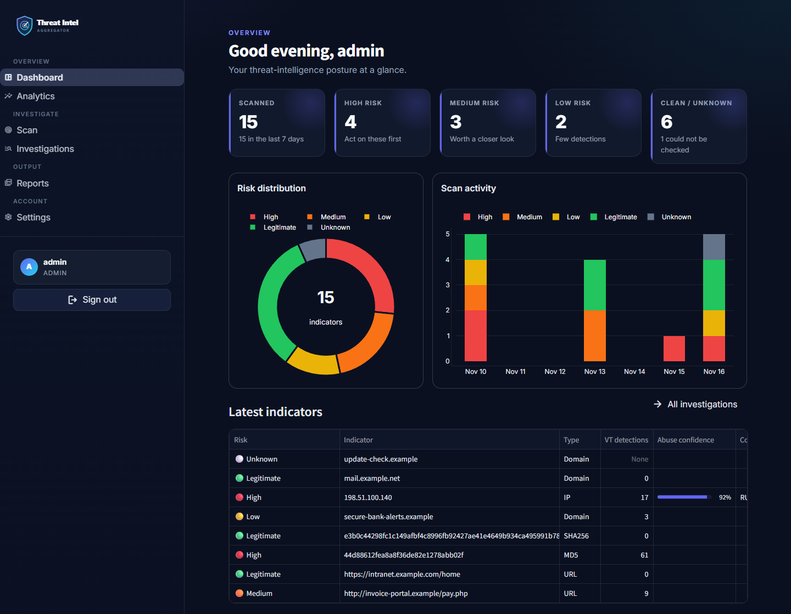
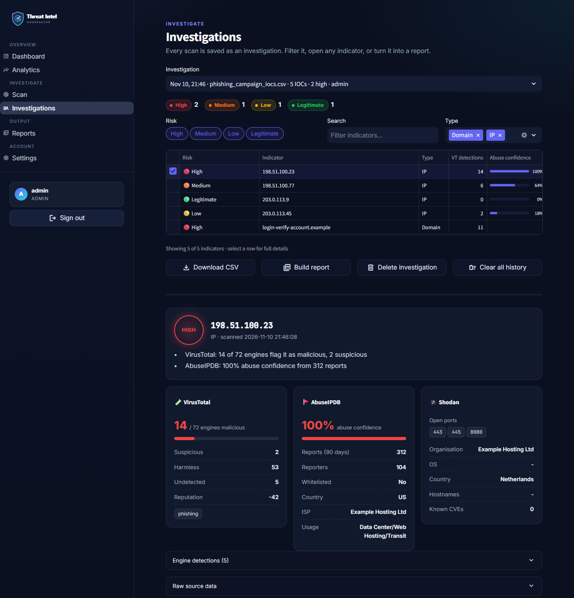

# Threat Intel Aggregator

A web dashboard that checks indicators of compromise (IP addresses, domains, URLs and file hashes) against **VirusTotal**, **AbuseIPDB** and **Shodan** at once. It gives each one a risk verdict, keeps a searchable history and produces PDF reports.



## Features

- **One lookup, three sources.** Paste an indicator and get VirusTotal detections, AbuseIPDB abuse confidence and Shodan open ports side by side.
- **Clear risk verdicts.** High / Medium / Low / Legitimate is taken from the most severe source. If no source returned data, the result is **Unknown**, never falsely "clean".
- **Bulk scanning.** Paste a list or upload a CSV. Duplicates are removed, defanged input (`hxxp://evil[.]com`) is cleaned up automatically, and an optional pacing mode stays within free API limits.
- **Investigations.** Every scan is saved. Filter by risk, type or text, click any row for full details, and export to CSV.
- **Analytics.** Risk mix, daily activity, most-detected indicators and indicator types over any date range.
- **PDF reports.** A clean, branded report with summary tiles, a chart, key findings and the full table. Download it or email it over SMTP.
- **Accounts and roles.** Salted PBKDF2 password hashing, a first-run admin setup (no default passwords), admin and analyst roles, per-user history, and a short lockout after repeated failed logins.

| Scan & verdict | Investigations | PDF report |
|---|---|---|
|  |  |  |

*Screenshots use synthetic sample data (documentation IP ranges and `.example` domains).*

## Quick start

Requires Python 3.8 or newer.

```bash
git clone <your-repo-url>
cd threat-intel-aggregator
python -m venv .venv
# Windows: .venv\Scripts\activate    macOS/Linux: source .venv/bin/activate
pip install -r requirements.txt
streamlit run streamlit_app.py
```

Open http://localhost:8501. On first launch you'll be asked to create the administrator account. Then add your API keys under **Settings → API keys**.

Free API keys: [VirusTotal](https://www.virustotal.com/gui/join-us) · [AbuseIPDB](https://www.abuseipdb.com/register) · [Shodan](https://account.shodan.io/register)

### Configuration options

API keys can come from three places. The first one found wins:

1. `.streamlit/secrets.toml` (see [`.streamlit/secrets.toml.example`](.streamlit/secrets.toml.example))
2. Environment variables `VT_API_KEY`, `ABUSEIPDB_API_KEY`, `SHODAN_API_KEY`
3. The Settings page (stored in the local database)

Data is stored in `data/threatintel.db` (SQLite, git-ignored). Set `TI_DATA_DIR` to use a different folder.

## Running the tests

```bash
pip install -r requirements-dev.txt
pytest
```

## Documentation

See [DOCUMENTATION.md](DOCUMENTATION.md) for the architecture, risk rules, every page in detail, deployment, security notes and the changelog from version 1.

## Disclaimer

For defensive security work. Results depend on third-party feeds and can miss new or targeted threats. Treat a verdict as a starting point for analysis, not a final judgement.
